# Práctica: Instalación de MariaDB y PHP en Ubuntu 24.04 (Completando el LAMP)

- **Módulo:** Aplicaciones Web (SMR)[cite: 46]
- **Alumno:** Saba
- **Fecha:** Octubre 2026

---

## Índice
1. [Preparación del sistema](#apartado-1-preparación-del-sistema)
2. [Instalación de MariaDB](#apartado-2-instalación-de-mariadb)
3. [Comprobación del funcionamiento](#apartado-3-comprobación-del-funcionamiento)
4. [Comandos principales de administración](#apartado-4-comandos-principales-de-administración)
5. [¿Qué pasa si MariaDB está parado?](#apartado-5-qué-pasa-si-mariadb-está-parado)
6. [Instalación de PHP](#apartado-6-instalación-de-php)
7. [Comprobación final](#apartado-7-comprobación-final)

---

## Apartado 1. Preparación del sistema
Antes de empezar con la base de datos, dejamos activo únicamente el sitio web por defecto de Apache y actualizamos los paquetes del sistema operativo.

### Comandos ejecutados:
```bash
sudo a2ensite 000-default.conf
```
**¿Qué hace?**: Vuelve a habilitar el sitio web virtual predeterminado de Apache por seguridad.
```bash
sudo systemctl reload apache2
```
**¿Qué hace?**: Recarga la configuración del servidor web Apache para aplicar los cambios del sitio predeterminado.

```bash
sudo apt update
```
**¿Qué hace?**: Actualiza la lista local de paquetes y versiones disponibles en los repositorios oficiales de Ubuntu.

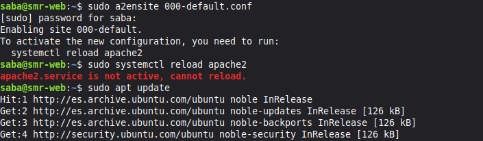

```bash
systemctl is-active apache2
```
**¿Qué hace?**: Comprueba de forma rápida si el servicio de Apache se encuentra ejecutándose correctamente (debe responder `active`).

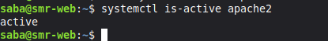


## Apartado 2. Instalación de MariaDB
Instalamos el sistema gestor de bases de datos relacionales MariaDB en nuestra máquina virtual con Ubuntu 24.04

```bash
sudo apt install mariadb-server -y
```
**¿Qué hace?**: Descarga e instala el paquete del servidor de bases de datos MariaDB de forma desatendida

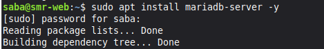

```bash
mariadb --version
```
**¿Qué hace?**: Consulta la versión exacta de MariaDB que se acaba de instalar en el sistema

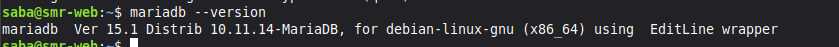


## Apartado 3. Comprobación del funcionamiento
Verificamos que el servicio de base de datos está activo, configurado para arrancar automáticamente con el sistema y probamos el acceso al monitor interactivo.

```bash
sudo systemctl status mariadb
```
**¿Qué hace?**: Muestra el estado detallado del servicio MariaDB, comprobando que está en ejecución (`active running`).

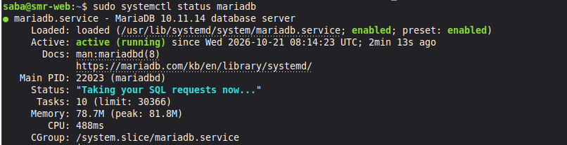

```bash
systemctl is-enabled mariadb
```
**¿Qué hace?**: Verifica si el servicio está configurado para iniciarse automáticamente cada vez que se enciende la máquina virtual (`enabled`).

```bash
sudo mariadb
```
**¿Qué hace?**: Accede al monitor de la base de datos con privilegios de administrador. Al entrar, el prompt cambia a `MariaDB [(none)]>`. (Para salir de la consola escribimos `exit` y pulsamos Enter)

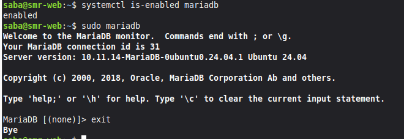

## Apartado 4. Comandos principales
Tabla resumen con los comandos esenciales para administrar el servicio de MariaDB.

 Comando | Función |
|------------|-------------|
| sudo systemctl start mariadb | Arranca el servicio de la base de datos |
| sudo systemctl stop mariadb | Detiene el servicio por completo |
| sudo systemctl restart mariadb | Reinicia el servicio cortando conexiones activas |
| sudo systemctl status mariadb | Muestra información detallada sobre el estado actual |
| sudo systemctl enable mariadb | Configura el arranque automático al encender el equipo |

## Apartado 5. ¿Qué pasa si MariaDB está parado?
Simulamos una caída del servicio de base de datos para aprender a diagnosticar errores comunes de conexión.

```bash
sudo systemctl stop mariadb
```
**¿Qué hace?**: Detiene a propósito el servicio de MariaDB

```bash
systemctl is-active mariadb
```
**Qué hace?**: Comprueba el estado, devolviendo `inactive`.

```bash
sudo mariadb
```
**¿Qué hace?**: Intenta abrir el monitor de MariaDB con el servicio detenido, generando un error de socket (`Can't connect to local server...`)

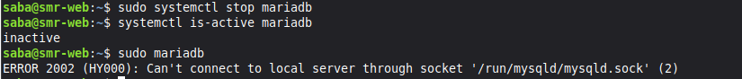

```bash
sudo systemctl start mariadb
```
**¿Qué hace?**: Vuelve a poner en marcha el servicio de base de datos

```bash
systemctl is-active mariadb
```
**¿Qué hace?**: Comprueba que el servicio ha vuelto a la normalidad respondiendo `active`

```bash
sudo mariadb
```
**¿Qué hace?**: Accede al monitor de la base de datos con privilegios de administrador. Al entrar, el prompt cambia a `MariaDB [(none)]>`. (Para salir de la consola escribimos `exit` y pulsamos Enter)

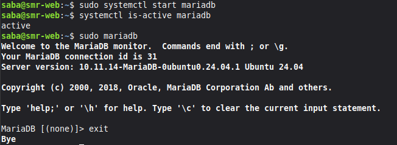

## Apartado 6. Instalación de PHP

WordPress está desarrollado en PHP, por lo que instalamos este lenguaje junto con todas las librerías y extensiones necesarias para su correcta ejecución

```bash
sudo apt install php libapache2-mod-php php-mysql php-curl php-gd php-mbstring php-xml php-zip php-intl -y
```
**¿Qué hace?**: Instala PHP 8.3 y los módulos imprescindibles (como `php-mysql` para conectar con MariaDB, `php-gd` para imágenes, `php-zip` para extensiones, etc.)

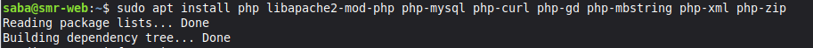

```bash
php -v
```
**¿Qué hace?**: Comprueba la versión instalada de PHP

```bash
sudo systemctl restart apache2
```
**¿Qué hace?**: Reinicia Apache para que cargue los módulos de PHP recién instalados

```bash
sudo apache2ctl -M | grep -E "mpm|php"
```
Qué hace?: Filtra los módulos activos de Apache para comprobar que `php_module` y `mpm_prefork_module` están funcionando.

```bash
php -m | grep -i mysql
```
**Qué hace?**: Comprueba que PHP cuenta con los controladores necesarios (mysqli, pdo_mysql) para hablar con MariaDB

```bash
echo '<?php phpinfo();' | sudo tee /var/www/html/info.php
```
**Gh Qué hace?**: Crea una página web temporal de pruebas en la raíz de Apache para verificar la ejecución de PHP. (Accede a `http://IP_DE_TU_SERVIDOR/info.php` desde el navegador).

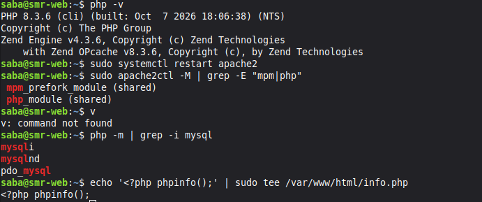

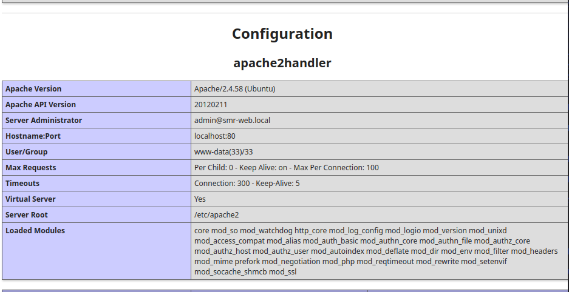


```bash
sudo rm /var/www/html/info.php
ls /var/www/html
```
**¿Qué hace?**: Borra obligatoriamente el fichero de pruebas `info.php` por motivos de seguridad y comprueba que se ha eliminado correctamente

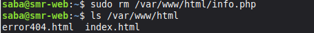

## Apartado 7. Comprobación final
Validamos que todos los componentes de la pila LAMP están activos y operativos al mismo tiempo

```bash
systemctl is-active apache2 mariadb
```
**¿Qué hace?**: Comprueba de un vistazo que tanto el servidor web como el servidor de base de datos están activos

```bash
php -v
```
**¿Qué hace?**: Muestra de nuevo la versión de PHP para confirmar que todo el entorno responde correctamente

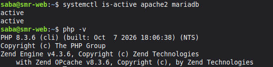


Pieza del LAMP |Programa | Estado |
|------------|-------------| ------------|
| Linux | Ubuntu 24.04 | Instalado y operativo |
| Apache | Apache2 | Funcionando |
| MariaDB | MariaDB 10.11 | Funcionando |
| PHP | PHP 8.3 | Funcionando y conectado a MariaDB |


